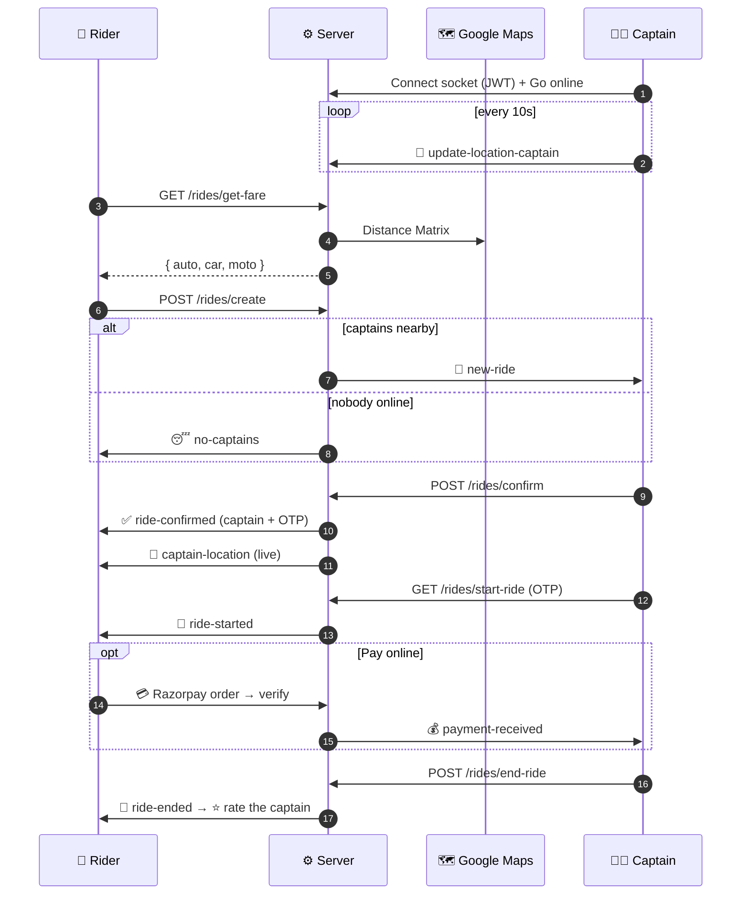

<div align="center">


<a href="https://github.com/mohityadav24952-ai/VeloxRide">
  
</a>

<br/>


**[✨ Features](#-features)** •
**[🛠️ Tech Stack](#️-tech-stack)** •
**[🔄 How it works](#-how-a-ride-works)** •
**[🚀 Quick Start](#-quick-start)** •
**[📡 API](#-api-reference)** •
**[🗺️ Roadmap](#️-roadmap)**

</div>

---

## 🚖 What is VeloxRide?

**VeloxRide** is a full-stack, real-time ride-hailing web app. Riders book a trip and watch their captain arrive live on the map. Captains go online, accept nearby requests, and track their earnings. Every update (accepted, started, cancelled, paid, ended) arrives instantly over WebSockets.

<table>
<tr>
<td width="50%" valign="top">

### 🧍 For Riders
- 🔍 **Smart search** with Google Places autocomplete
- 💰 **Instant fares** for 3 vehicle types
- 🔐 **6-digit OTP** to start the trip safely
- 📍 **Live captain tracking** on the map
- 💳 **Pay online** (Razorpay) or 💵 cash
- ⭐ **Rate your captain** after every ride
- 🧾 **Ride history** with fares and ratings
- ❌ **Cancel** any time before the trip starts

</td>
<td width="50%" valign="top">

### 🧑‍✈️ For Captains
- 🟢 **Go online / offline** with one tap
- 📡 **Nearby requests** within 2 km, same vehicle type
- ✅ **Accept → OTP → Start → Finish** flow
- 💸 **Today's earnings** and ride count
- ⭐ **Average rating** from riders
- 🔔 **Payment alerts** when a rider pays online
- 🧾 **Ride history**
- ❌ **Cancel** an accepted ride before it starts

</td>
</tr>
</table>

### 🚗 Ride options

| | Type | Seats | Base | Per km | Per min |
|:-:|------|:-----:|:----:|:------:|:-------:|
| 🚗 | **Velox Go** (car) | 4 | ₹50 | ₹15 | ₹3 |
| 🏍️ | **Velox Moto** | 1 | ₹20 | ₹8 | ₹1.5 |
| 🛺 | **Velox Auto** | 3 | ₹30 | ₹10 | ₹2 |

> 🧮 `fare = base + km × per_km + minutes × per_min`. For example, a 5 km, 15 min Velox Go ride costs 50 + 75 + 45 = **₹170**.

---

## ✨ Features

<details open>
<summary><b>⚡ Real-time & safety</b></summary>
<br/>

- 🔌 **JWT-authenticated Socket.IO**: sockets are verified on connect and re-register automatically after a reconnect
- 🗺️ **Geo search** with MongoDB `2dsphere`: only **online, free** captains with the **right vehicle** get the request
- 🔒 **One captain per ride**: a ride can only be accepted once
- 🙅 **One active ride per rider**
- 😴 **No captain nearby?** The rider is told right away and the ride is auto-cancelled
- 🔄 **Refresh-proof**: an active ride comes back after a page reload

</details>

<details>
<summary><b>🔐 Auth & security</b></summary>
<br/>

- 🔑 JWT auth (24h) with **bcrypt** password hashing
- 🚫 **Token blacklist** on logout (auto-expires after 24h)
- 👥 Separate rider and captain sessions, so one browser can hold both
- 🛡️ **Rate limiting** on login/register and the Google Maps endpoints
- ✅ Input validation on every endpoint with `express-validator`
- 🧾 Razorpay payments verified with an **HMAC-SHA256 signature**

</details>

<details>
<summary><b>🎨 UI / UX</b></summary>
<br/>

- 📱 Mobile-first design with **Tailwind CSS**
- 🎞️ Smooth slide-up panels animated with **GSAP**
- 🗺️ Live Google Map with your position and your captain's
- 🎯 Clear error messages on every action

</details>

---

## 🛠️ Tech Stack

<div align="center">


</div>

<br/>

| Layer | Technologies |
|-------|--------------|
| 🎨 **Frontend** | React 18 · Vite 5 · React Router 6 · Tailwind CSS 3 · GSAP · Axios · Remix Icon |
| ⚙️ **Backend** | Node.js · Express 4 · express-validator · express-rate-limit · cookie-parser · CORS |
| 🗄️ **Database** | MongoDB · Mongoose 8 (GeoJSON + `2dsphere` index) |
| ⚡ **Realtime** | Socket.IO 4 with JWT handshake auth |
| 🗺️ **Maps** | Google Maps JavaScript API · Geocoding · Distance Matrix · Places Autocomplete |
| 💳 **Payments** | Razorpay Orders API + Checkout.js *(optional)* |
| 🔐 **Auth** | JWT · bcrypt · token blacklist with TTL |
| 🧪 **Testing** | Node's built-in test runner (`node --test`) |

---

## 🔄 How a Ride Works



**Ride lifecycle:** `🕓 pending → ✅ accepted → 🚗 ongoing → 🏁 completed` · or `❌ cancelled` (by the rider, the captain, or the system)

---

## 🚀 Quick Start

### 📋 Prerequisites

- 🟩 **Node.js 18+** and npm
- 🍃 **MongoDB** (local or a free [MongoDB Atlas](https://www.mongodb.com/atlas) cluster)
- 🗺️ **Google Cloud API key** with *Maps JavaScript*, *Geocoding*, *Distance Matrix* and *Places* APIs turned on
- 💳 *(Optional)* **Razorpay test keys** for online payments

### ⚙️ Setup

```bash
# 1️⃣ Clone
git clone https://github.com/mohityadav24952-ai/VeloxRide.git
cd VeloxRide

# 2️⃣ Backend  →  http://localhost:3000
cd Backend
npm install
cp .env.example .env      # fill in your values
npm run dev

# 3️⃣ Frontend  →  http://localhost:5173
cd ../frontend
npm install
cp .env.example .env      # fill in your values
npm run dev
```

<details>
<summary><b>🔑 Environment variables</b></summary>
<br/>

> ⚠️ `.env` files are git-ignored. **Never commit your keys.**

**`Backend/.env`**

| Variable | Required | Description |
|----------|:--------:|-------------|
| `PORT` | ➖ | Server port (default `3000`) |
| `DB_CONNECT` | ✅ | MongoDB connection string |
| `JWT_SECRET` | ✅ | Long random string for signing JWTs |
| `GOOGLE_MAPS_API` | ✅ | Google Maps server key |
| `CLIENT_URL` | ➖ | Frontend origin for CORS/Socket.IO, e.g. `http://localhost:5173` |
| `RAZORPAY_KEY_ID` | ➖ | Razorpay key id. Leave empty for cash only |
| `RAZORPAY_KEY_SECRET` | ➖ | Razorpay key secret |

**`frontend/.env`**

| Variable | Required | Description |
|----------|:--------:|-------------|
| `VITE_BASE_URL` | ✅ | Backend URL, e.g. `http://localhost:3000` |
| `VITE_GOOGLE_MAPS_API_KEY` | ✅ | Google Maps browser key |

💡 Generate a JWT secret:

```bash
node -e "console.log(require('crypto').randomBytes(48).toString('hex'))"
```

</details>

### 🧪 Try a full ride

1. 🧑‍✈️ Sign up as a **captain** at `/captain-signup`, allow location access, and tap **Go online**
2. 🧍 In another tab, sign up as a **rider** at `/signup`
3. 📍 Pick a pickup within ~2 km of the captain and choose the **same vehicle type**
4. ✅ Accept in the captain tab → enter the rider's **OTP** → start the ride
5. 🏁 Finish the ride, and the rider gets the ⭐ rating screen

### ✅ Run tests

```bash
cd Backend && npm test
```

---

## 📡 API Reference

> Protected routes need `Authorization: Bearer <token>`. Errors come back as `{ message }`; validation errors as `{ errors: [...] }`.

<details>
<summary><b>👤 Users</b> · <code>/users</code></summary>
<br/>

| Method | Endpoint | Auth | Body / Query |
|--------|----------|:----:|--------------|
| `POST` | `/users/register` | – | `fullname.firstname`, `fullname.lastname?`, `email`, `password` |
| `POST` | `/users/login` | – | `email`, `password` |
| `GET` | `/users/profile` | 🧍 | – |
| `GET` | `/users/logout` | 🧍 | – (blacklists the token) |

</details>

<details>
<summary><b>🧑‍✈️ Captains</b> · <code>/captains</code></summary>
<br/>

| Method | Endpoint | Auth | Body / Query |
|--------|----------|:----:|--------------|
| `POST` | `/captains/register` | – | user fields + `vehicle.{color, plate, capacity, vehicleType}` |
| `POST` | `/captains/login` | – | `email`, `password` |
| `GET` | `/captains/profile` | 🧑‍✈️ | – |
| `PATCH` | `/captains/status` | 🧑‍✈️ | `status`: `active` \| `inactive` |
| `GET` | `/captains/stats` | 🧑‍✈️ | → `{ todayEarnings, todayRides, totalEarnings, totalRides }` |
| `GET` | `/captains/logout` | 🧑‍✈️ | – |

</details>

<details>
<summary><b>🚖 Rides</b> · <code>/rides</code></summary>
<br/>

| Method | Endpoint | Auth | Body / Query |
|--------|----------|:----:|--------------|
| `GET` | `/rides/get-fare` | 🧍 | `pickup`, `destination` |
| `POST` | `/rides/create` | 🧍 | `pickup`, `destination`, `vehicleType` |
| `POST` | `/rides/cancel` | 🧍 | `rideId` |
| `POST` | `/rides/rate` | 🧍 | `rideId`, `rating` (1–5), `feedback?` |
| `GET` | `/rides/active` | 🧍 | – |
| `GET` | `/rides/history` | 🧍 | – |
| `POST` | `/rides/confirm` | 🧑‍✈️ | `rideId` |
| `GET` | `/rides/start-ride` | 🧑‍✈️ | `rideId`, `otp` |
| `POST` | `/rides/end-ride` | 🧑‍✈️ | `rideId` |
| `POST` | `/rides/captain/cancel` | 🧑‍✈️ | `rideId` |
| `GET` | `/rides/captain/active` | 🧑‍✈️ | – |
| `GET` | `/rides/captain/history` | 🧑‍✈️ | – |

</details>

<details>
<summary><b>🗺️ Maps</b> · <code>/maps</code></summary>
<br/>

| Method | Endpoint | Query | Returns |
|--------|----------|-------|---------|
| `GET` | `/maps/get-coordinates` | `address` | `{ ltd, lng }` |
| `GET` | `/maps/get-distance-time` | `origin`, `destination` | distance + duration |
| `GET` | `/maps/get-suggestions` | `input` | `string[]` |

</details>

<details>
<summary><b>💳 Payments</b> · <code>/payments</code></summary>
<br/>

| Method | Endpoint | Body | Notes |
|--------|----------|------|-------|
| `GET` | `/payments/config` | – | `{ enabled, keyId }` |
| `POST` | `/payments/create-order` | `rideId` | Ride must be ongoing and unpaid |
| `POST` | `/payments/verify` | `rideId`, `razorpay_order_id`, `razorpay_payment_id`, `razorpay_signature` | Verifies the signature and notifies the captain |

</details>

<details>
<summary><b>⚡ Socket.IO events</b></summary>
<br/>

Connect with `io(VITE_BASE_URL, { auth: { token, userType } })`.

| Event | Direction | Purpose |
|-------|-----------|---------|
| 📍 `update-location-captain` | captain → server | Save location and relay it to the rider |
| 🔔 `new-ride` | server → captain | New request nearby |
| ✅ `ride-confirmed` | server → rider | Captain accepted (includes OTP) |
| 📍 `captain-location` | server → rider | Live captain position |
| 🚦 `ride-started` | server → rider | OTP verified |
| 💰 `payment-received` | server → captain | Rider paid online |
| 🏁 `ride-ended` | server → rider | Trip completed |
| ❌ `ride-cancelled` | server → both | The other side cancelled |
| 😴 `no-captains` | server → rider | Nobody available nearby |

</details>

---

## 📁 Project Structure

<details>
<summary><b>Show folder tree</b></summary>

```
VeloxRide/
├── ⚙️ Backend/
│   ├── server.js              # HTTP server + Socket.IO bootstrap
│   ├── app.js                 # Express app, rate limits, routes
│   ├── socket.js              # JWT socket auth, live tracking relay
│   ├── models/                # user, captain, ride, blacklistToken
│   ├── routes/                # users, captains, maps, rides, payments
│   ├── controllers/           # request handling
│   ├── services/              # rides, fares, maps, Razorpay
│   ├── middlewares/           # JWT auth
│   └── test/                  # unit tests
│
└── 🎨 frontend/src/
    ├── pages/                 # Home, Riding, CaptainHome, RideHistory, auth...
    ├── components/            # ride panels, RateRide, LiveTracking, Logo...
    ├── context/               # User, Captain, Socket contexts
    ├── hooks/                 # useCaptainLocation
    └── utils/                 # api, format, payment helpers
```

</details>

---

## 🗺️ Roadmap

- [x] 🚖 Booking with live fares
- [x] 🔐 OTP-verified trip start
- [x] 📍 Live captain tracking
- [x] 💳 Razorpay payments
- [x] ⭐ Ratings and 🧾 ride history
- [x] ❌ Cancellations
- [ ] 🔁 Re-offer pending rides to captains who come online later
- [ ] 🛣️ Route line between captain and rider
- [ ] 💸 Automatic refunds on cancellation
- [ ] 👤 Profile editing
- [ ] 🧪 Frontend tests
- [ ] ☁️ One-click deployment guide

---

## 🙏 Acknowledgements

Built on the open-source *uber-video* project by Ankur Prajapati and Sarthak Sharma.

---

<div align="center">

### 💛 Made with passion by [Mohit Kumar Yadav](https://github.com/mohityadav24952-ai)

If you like this project, give it a ⭐ on GitHub!


</div>
