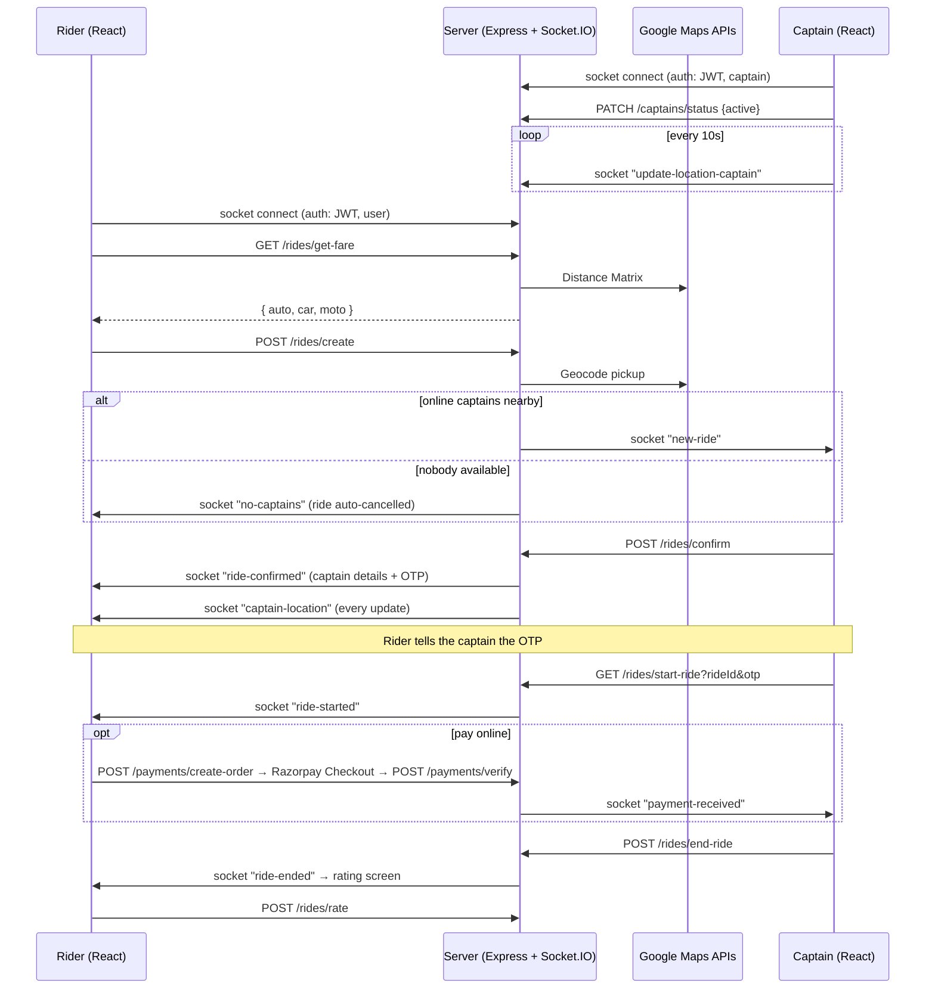

# VeloxRide 🚖

A full-stack, real-time **ride-hailing web app** built on the MERN stack with Socket.IO, Google Maps and Razorpay.

Two kinds of people use it:

- **Riders (users)** search for a pickup and destination, compare fares for three vehicle types, book a ride, track the captain live, pay in cash or online, and rate the trip.
- **Captains (drivers)** go online, get ride requests from nearby riders in real time, accept them, check the rider's OTP to start the trip, finish it, and see their earnings.

---

## Table of Contents

- [Features](#features)
- [Tech Stack](#tech-stack)
- [How a Ride Works](#how-a-ride-works)
- [Project Structure](#project-structure)
- [Getting Started](#getting-started)
- [Environment Variables](#environment-variables)
- [Testing](#testing)
- [API Reference](#api-reference)
- [Socket.IO Events](#socketio-events)
- [Fare Calculation](#fare-calculation)
- [Data Models](#data-models)
- [Known Limitations](#known-limitations)
- [Roadmap](#roadmap)

---

## Features

**Rider**
- Sign up, log in and log out with JWT. Logged-out tokens go on a blacklist.
- Location autocomplete through the Google Places API
- Fare estimates for **Velox Go** (car), **Velox Moto** and **Velox Auto**, based on distance and time from the Google Distance Matrix API
- Book a ride and get a **6-digit OTP** to share with the captain
- **Cancel** the ride any time before it starts
- **Live captain location** on the map after the ride is accepted
- **Pay online with Razorpay** during the trip, or pay cash at drop-off
- **Rate the captain** (1–5 stars + optional feedback) after the ride
- **Ride history** with status, fare and rating
- Told right away when no captain is available nearby
- An active ride comes back after a page refresh

**Captain**
- Sign up with vehicle details (color, plate, capacity, type)
- **Online / offline toggle.** Only online captains get ride requests
- Gets a `new-ride` request when a rider books a **matching vehicle type within 2 km** (MongoDB `2dsphere` geo query). Captains already on a ride are skipped
- Accept → enter the rider's OTP → start the ride → finish the ride
- Can cancel an accepted ride before it starts
- Sees when the rider has paid online, so they know whether to collect cash
- Dashboard with **today's earnings, today's rides and average rating**
- Ride history

**Platform**
- Socket.IO connections are **authenticated with the JWT** and re-register automatically after a reconnect
- Riders and captains use **separate tokens**, so one browser can be logged in as both
- A ride can only be accepted once, and a rider can only have one active ride
- Rate limiting on login/register and the Google Maps endpoints
- Mobile-first UI with Tailwind CSS and GSAP slide-up panels

---

## Tech Stack

| Layer     | Technology |
|-----------|------------|
| Frontend  | React 18, Vite 5, React Router 6, Tailwind CSS 3, GSAP, Axios, Remix Icon |
| Maps      | `@react-google-maps/api` (client), Google Geocoding / Distance Matrix / Places Autocomplete (server) |
| Realtime  | Socket.IO (server) + `socket.io-client`, JWT handshake auth |
| Payments  | Razorpay Orders API + Checkout.js (optional) |
| Backend   | Node.js, Express 4, express-validator, express-rate-limit, cookie-parser, CORS |
| Database  | MongoDB with Mongoose 8 |
| Auth      | JWT (24h expiry), bcrypt password hashing, token blacklist with a 24h TTL |
| Tests     | Node's built-in test runner (`node --test`) |

---

## How a Ride Works



Ride status lifecycle: `pending → accepted → ongoing → completed`, or `cancelled` (by the rider, the captain, or the system when no captain is found).

---

## Project Structure

```
VeloxRide/
├── Backend/
│   ├── server.js              # HTTP server + Socket.IO bootstrap
│   ├── app.js                 # Express app, middleware, rate limits, route mounting
│   ├── socket.js              # JWT socket auth, location updates, live tracking relay
│   ├── db/db.js               # Mongoose connection
│   ├── middlewares/           # authUser / authCaptain (JWT + blacklist check)
│   ├── models/                # user, captain, ride, blacklistToken
│   ├── routes/                # /users, /captains, /maps, /rides, /payments
│   ├── controllers/           # Request handling + validation results
│   ├── services/              # Business logic: rides, fares, maps, Razorpay
│   ├── utils/httpError.js     # Errors that carry an HTTP status
│   ├── test/                  # Unit tests (node --test)
│   └── README.md              # Detailed docs for user & captain auth endpoints
│
└── frontend/
    └── src/
        ├── main.jsx           # Context providers + Router
        ├── App.jsx            # Route table
        ├── context/           # UserContext, CaptainContext, SocketContext (connectAs / disconnect)
        ├── hooks/             # useCaptainLocation (GPS → socket every 10s)
        ├── utils/             # api.js (tokens, headers, errors), format.js, payment.js (Razorpay)
        ├── pages/             # Start, auth pages, Home, Riding, CaptainHome, CaptainRiding, RideHistory
        └── components/        # Ride panels, RateRide, CaptainDetails, LiveTracking, shared UI
```

### Frontend routes

| Path | Page | Protected |
|------|------|-----------|
| `/` | Start / landing | – |
| `/login`, `/signup` | Rider auth | – |
| `/home` | Rider home (search, fare, booking, cancel) | Rider |
| `/riding` | Active ride: live captain, payment, rating | Rider |
| `/history` | Rider's past rides | Rider |
| `/user/logout` | Rider logout | Rider |
| `/captain-login`, `/captain-signup` | Captain auth | – |
| `/captain-home` | Dashboard: online toggle, stats, incoming requests | Captain |
| `/captain-riding` | Captain's active ride | Captain |
| `/captain/history` | Captain's past rides | Captain |
| `/captain/logout` | Captain logout | Captain |

---

## Getting Started

### Prerequisites

- Node.js 18+ and npm
- MongoDB (local install or a free MongoDB Atlas cluster)
- A Google Cloud API key with these APIs turned on: **Maps JavaScript API**, **Geocoding API**, **Distance Matrix API** and **Places API**
- *(Optional)* Razorpay **test** keys for online payments

### 1. Clone

```bash
git clone https://github.com/mohityadav24952-ai/VeloxRide.git
cd VeloxRide
```

### 2. Backend

```bash
cd Backend
npm install
cp .env.example .env       # then fill in the values
npm run dev                # auto-restarts on changes (node --watch); use `npm start` in production
```

The server runs on `http://localhost:3000` (or `PORT`).

### 3. Frontend

```bash
cd ../frontend
npm install
cp .env.example .env       # then fill in the values
npm run dev
```

Open the URL Vite prints (usually `http://localhost:5173`).

### 4. Try a full ride

1. Sign up as a **captain** at `/captain-signup` and tap **Go online**. Allow location access.
2. In another tab, sign up as a **rider** at `/signup`. Pick a pickup within about 2 km of where the captain's browser is, choose the same vehicle type the captain registered, and book.
3. Accept the request in the captain tab, type the OTP the rider sees, and start the ride.
4. Finish the ride from the captain tab. The rider gets the rating screen.

---

## Environment Variables

`.env` files are git-ignored. **Never commit your API keys or secrets.**

### `Backend/.env`

| Variable | Required | Description | Example |
|----------|----------|-------------|---------|
| `PORT` | no | Server port (default `3000`) | `3000` |
| `DB_CONNECT` | yes | MongoDB connection string | `mongodb://127.0.0.1:27017/veloxride` |
| `JWT_SECRET` | yes | Secret for signing JWTs | a long random string |
| `GOOGLE_MAPS_API` | yes | Google Maps server-side API key | `AIza...` |
| `CLIENT_URL` | no | Frontend origin allowed by CORS and Socket.IO. Empty allows all origins (development only) | `http://localhost:5173` |
| `RAZORPAY_KEY_ID` | no | Razorpay key id. Leave empty for cash only | `rzp_test_...` |
| `RAZORPAY_KEY_SECRET` | no | Razorpay key secret | |

### `frontend/.env`

| Variable | Required | Description | Example |
|----------|----------|-------------|---------|
| `VITE_BASE_URL` | yes | Backend URL, used for REST and Socket.IO | `http://localhost:3000` |
| `VITE_GOOGLE_MAPS_API_KEY` | yes | Google Maps browser key for the live map | `AIza...` |

Both folders have a `.env.example` you can copy.

---

## Testing

```bash
cd Backend
npm test
```

Unit tests cover the fare formula, OTP generation and Razorpay signature checks. The full ride flow (signup → socket auth → booking → accept → live location → OTP → end → rating → cancellations → logout) has also been checked against an in-memory MongoDB with Google Maps stubbed out.

---

## API Reference

Protected routes take the JWT in an `Authorization: Bearer <token>` header. Request and response examples for the user and captain auth endpoints are in [`Backend/README.md`](Backend/README.md). Errors come back as `{ message }`, and validation errors as `{ errors: [...] }`.

### Users — `/users`

| Method | Endpoint | Auth | Body / Query |
|--------|----------|------|--------------|
| POST | `/users/register` | – | `fullname.firstname` (≥3), `fullname.lastname?`, `email`, `password` (≥6) |
| POST | `/users/login` | – | `email`, `password` |
| GET | `/users/profile` | User | – |
| GET | `/users/logout` | User | – (blacklists the token) |

### Captains — `/captains`

| Method | Endpoint | Auth | Body / Query |
|--------|----------|------|--------------|
| POST | `/captains/register` | – | user fields + `vehicle.color`, `vehicle.plate`, `vehicle.capacity` (≥1), `vehicle.vehicleType` (`car` \| `moto` \| `auto`) |
| POST | `/captains/login` | – | `email`, `password` |
| GET | `/captains/profile` | Captain | – (includes `status` and `rating`) |
| PATCH | `/captains/status` | Captain | `status`: `active` (online) \| `inactive` |
| GET | `/captains/stats` | Captain | → `{ todayEarnings, todayRides, totalEarnings, totalRides }` |
| GET | `/captains/logout` | Captain | – |

### Maps — `/maps` (rider auth)

| Method | Endpoint | Query | Returns |
|--------|----------|-------|---------|
| GET | `/maps/get-coordinates` | `address` | `{ ltd, lng }` |
| GET | `/maps/get-distance-time` | `origin`, `destination` | Google Distance Matrix element (`distance`, `duration`) |
| GET | `/maps/get-suggestions` | `input` | `string[]` of place descriptions |

### Rides — `/rides`

| Method | Endpoint | Auth | Body / Query |
|--------|----------|------|--------------|
| GET | `/rides/get-fare` | User | `pickup`, `destination` → `{ auto, car, moto }` |
| POST | `/rides/create` | User | `pickup`, `destination`, `vehicleType` (`auto` \| `car` \| `moto`). 409 if the rider already has an active ride |
| POST | `/rides/cancel` | User | `rideId`. Allowed while `pending` or `accepted` |
| POST | `/rides/rate` | User | `rideId`, `rating` (1–5), `feedback?` (≤500 chars). Completed rides only, once |
| GET | `/rides/active` | User | → current ride (with OTP) or `null` |
| GET | `/rides/history` | User | → last 20 completed/cancelled rides |
| POST | `/rides/confirm` | Captain | `rideId`. 409 if the ride is no longer `pending` |
| GET | `/rides/start-ride` | Captain | `rideId`, `otp` (6 digits). Only the captain who accepted the ride |
| POST | `/rides/end-ride` | Captain | `rideId`. Marks it paid in cash if it wasn't paid online |
| POST | `/rides/captain/cancel` | Captain | `rideId`. Allowed while `accepted` |
| GET | `/rides/captain/active` | Captain | → current accepted/ongoing ride or `null` |
| GET | `/rides/captain/history` | Captain | → last 20 completed/cancelled rides |

### Payments — `/payments` (rider auth)

| Method | Endpoint | Body | Notes |
|--------|----------|------|-------|
| GET | `/payments/config` | – | `{ enabled, keyId }`. `enabled` is false until Razorpay keys are set |
| POST | `/payments/create-order` | `rideId` | Ride must be `ongoing` and unpaid. 503 if payments aren't configured |
| POST | `/payments/verify` | `rideId`, `razorpay_order_id`, `razorpay_payment_id`, `razorpay_signature` | Checks the HMAC signature, marks the ride paid and notifies the captain |

---

## Socket.IO Events

Clients connect with `io(VITE_BASE_URL, { auth: { token, userType } })`. The server checks the JWT (and the blacklist) before accepting the connection, then saves the socket id on the account.

| Event | Direction | Payload | Purpose |
|-------|-----------|---------|---------|
| `update-location-captain` | captain → server | `{ location: { ltd, lng } }` | Stored as a GeoJSON point `[lng, lat]`, and relayed to the rider during a ride |
| `new-ride` | server → captain | ride (with rider populated) | Ride request near an online, free captain |
| `ride-confirmed` | server → rider | ride (captain + OTP) | A captain accepted the ride |
| `captain-location` | server → rider | `{ rideId, location: { lat, lng } }` | Live position of the rider's captain |
| `ride-started` | server → rider | ride | OTP verified, trip started |
| `payment-received` | server → captain | `{ rideId, amount }` | Rider paid online |
| `ride-ended` | server → rider | ride | Trip completed |
| `ride-cancelled` | server → rider / captain | `{ rideId, cancelledBy }` | The other side cancelled |
| `no-captains` | server → rider | `{ rideId }` | Nobody available. The ride was auto-cancelled |
| `error` | server → client | `{ message }` | Invalid location data |

---

## Fare Calculation

`fare = base + (distance_km × per_km) + (duration_min × per_min)`, rounded to the nearest rupee. Distance and duration come from the Google Distance Matrix API.

| Vehicle | Base (₹) | Per km (₹) | Per min (₹) |
|---------|----------|-----------|-------------|
| Auto | 30 | 10 | 2 |
| Car | 50 | 15 | 3 |
| Moto | 20 | 8 | 1.5 |

Example: a 5 km, 15 min car trip costs 50 + 75 + 45 = **₹170**.

The rates live in the `RATES` table in `Backend/services/ride.service.js`.

---

## Data Models

- **User** — `fullname { firstname, lastname }`, `email` (unique), `password` (bcrypt, `select: false`), `socketId`
- **Captain** — user fields + `status` (`active` = online / `inactive`), `vehicle { color, plate, capacity, vehicleType }`, `location` (GeoJSON `Point`, `2dsphere` index), `rating { average, count }`
- **Ride** — `user`, `captain` (refs), `pickup`, `destination`, `vehicleType`, `fare`, `status`, `cancelledBy`, `distance` (m), `duration` (s), `completedAt`, `paymentStatus` (`unpaid`/`paid`), `paymentMethod` (`cash`/`online`), `paymentID`, `orderId`, `signature`, `rating`, `feedback`, `otp` (`select: false`), `createdAt`/`updatedAt`
- **BlacklistToken** — `token`, `createdAt` (TTL index, auto-deleted after 24h)

> **Upgrading an old database?** Captain locations used to be stored as `{ ltd, lng }`. Clear them once (`db.captains.updateMany({}, { $unset: { location: "" } })`) so the `2dsphere` index can build. Captains send a fresh location within 10 seconds of opening the app.

---

## Known Limitations

- **Ride search runs once.** Captains who come online after a ride is booked don't see it. The rider has to book again.
- **Location updates every 10 seconds**, so the captain's marker moves in steps, not smoothly.
- **"Today" in captain stats uses the server's timezone.** Deploy with `TZ=Asia/Kolkata` (or your timezone) to match.
- **No refunds.** If a ride paid online is cancelled, the money has to be refunded from the Razorpay dashboard.
- **No frontend tests**, and ESLint still reports style issues (mostly missing `prop-types`).

---

## Roadmap

- [ ] Re-offer pending rides to captains who come online later, with a timeout
- [ ] Route line between captain and rider on the map
- [ ] Razorpay webhooks + automatic refunds on cancellation
- [ ] Profile pages (edit name, vehicle, password)
- [ ] Frontend tests (Vitest + React Testing Library) and API tests (Supertest)
- [ ] Deployment guide (Render/Railway for the backend, Vercel/Netlify for the frontend)

---

## Credits

Based on the original *uber-video* project by Ankur Prajapati (Ankur77720) and Sarthak (saarthack). Bug fixes, new features, VeloxRide rebranding and documentation by mohityadav24952-ai.

---

## License

No license file yet. Add one (for example MIT) before others reuse the code.
