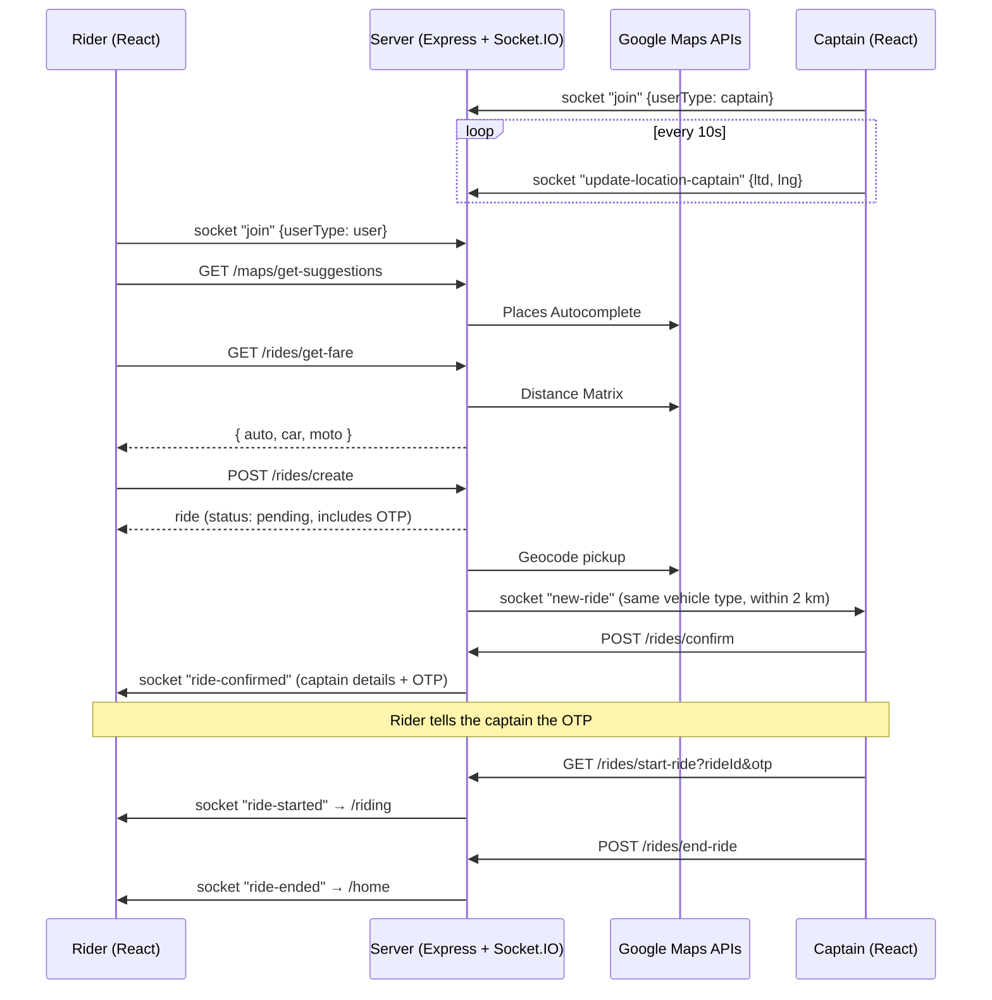

# VeloxRide 🚖

A full-stack, real-time **ride-hailing web app** built on the MERN stack with Socket.IO and Google Maps.

Two kinds of people use it:

- **Riders (users)** search for a pickup and destination, see fare estimates for three vehicle types, and book a ride.
- **Captains (drivers)** go online, get ride requests from nearby riders in real time, accept them, check the rider's OTP to start the trip, and finish it.

---

## Table of Contents

- [Features](#features)
- [Tech Stack](#tech-stack)
- [How a Ride Works](#how-a-ride-works)
- [Project Structure](#project-structure)
- [Getting Started](#getting-started)
- [Environment Variables](#environment-variables)
- [API Reference](#api-reference)
- [Socket.IO Events](#socketio-events)
- [Fare Calculation](#fare-calculation)
- [Data Models](#data-models)
- [Known Limitations](#known-limitations)
- [Roadmap](#roadmap)

---

## Features

**Rider**
- Sign up, log in and log out with JWT. Logged-out tokens go on a blacklist.
- Location autocomplete through the Google Places API
- Fare estimates for **Velox Go** (car), **Velox Moto** and **Velox Auto**, based on distance and time from the Google Distance Matrix API
- Book a ride and get a **6-digit OTP** to share with the captain
- Live updates when a captain accepts, starts and ends the ride
- Live map of the rider's current position (Google Maps)

**Captain**
- Sign up with vehicle details (color, plate, capacity, type)
- Sends its GPS location to the server every 10 seconds over Socket.IO
- Gets a `new-ride` request when a rider books a **matching vehicle type within 2 km** (MongoDB `2dsphere` geo query)
- Accept → enter the rider's OTP → start the ride → finish the ride
- A ride can only be accepted once, so two captains can't take the same ride

**UI**
- Mobile-first layout with Tailwind CSS
- Slide-up panels animated with GSAP

---

## Tech Stack

| Layer     | Technology |
|-----------|------------|
| Frontend  | React 18, Vite 5, React Router 6, Tailwind CSS 3, GSAP, Axios, Remix Icon |
| Maps      | `@react-google-maps/api` (client), Google Geocoding / Distance Matrix / Places Autocomplete (server) |
| Realtime  | Socket.IO (server) + `socket.io-client` |
| Backend   | Node.js, Express 4, express-validator, cookie-parser, CORS |
| Database  | MongoDB with Mongoose 8 |
| Auth      | JWT (24h expiry), bcrypt password hashing, token blacklist with a 24h TTL |

---

## How a Ride Works



Ride status lifecycle: `pending → accepted → ongoing → completed` (`cancelled` is in the schema but no code uses it yet).

---

## Project Structure

```
VeloxRide/
├── Backend/
│   ├── server.js              # HTTP server + Socket.IO bootstrap
│   ├── app.js                 # Express app, middleware, route mounting
│   ├── socket.js              # Socket.IO events + sendMessageToSocketId helper
│   ├── db/db.js               # Mongoose connection
│   ├── middlewares/
│   │   └── auth.middleware.js # authUser / authCaptain (JWT + blacklist check)
│   ├── models/                # user, captain, ride, blacklistToken
│   ├── routes/                # /users, /captains, /maps, /rides
│   ├── controllers/           # Request handling + validation results
│   ├── services/              # Business logic (fare, OTP, Google Maps, geo query)
│   └── README.md              # Detailed docs for user & captain endpoints
│
└── frontend/
    ├── index.html
    ├── vite.config.js
    ├── tailwind.config.js
    └── src/
        ├── main.jsx           # Context providers + Router
        ├── App.jsx            # Route table
        ├── context/           # UserContext, CaptainContext, SocketContext
        ├── utils/             # api.js (base URL, auth header, error messages), format.js (vehicles, distance, names)
        ├── pages/             # Start, Login/Signup, Home, Riding, CaptainHome, CaptainRiding, protect wrappers
        └── components/        # Ride panels (VehiclePanel, ConfirmRide, WaitingForDriver, RidePopUp, FinishRide, ...)
                               # + shared UI: Logo, VehicleIcon, Avatar, TripDetails, RiderCard, LiveTracking
```

### Frontend routes

| Path | Page | Protected |
|------|------|-----------|
| `/` | Start / landing | – |
| `/login`, `/signup` | Rider auth | – |
| `/home` | Rider home (search, fare, booking) | Rider |
| `/riding` | Rider's active ride | Rider |
| `/user/logout` | Rider logout | Rider |
| `/captain-login`, `/captain-signup` | Captain auth | – |
| `/captain-home` | Captain dashboard (incoming requests) | Captain |
| `/captain-riding` | Captain's active ride | Captain |
| `/captain/logout` | Captain logout | Captain |

---

## Getting Started

### Prerequisites

- Node.js 18+ and npm
- MongoDB (local install or MongoDB Atlas)
- A Google Cloud API key with these APIs turned on: **Maps JavaScript API**, **Geocoding API**, **Distance Matrix API** and **Places API**

### 1. Clone

```bash
git clone https://github.com/mohityadav24952-ai/VeloxRide.git
cd VeloxRide
```

### 2. Backend

```bash
cd Backend
npm install
cp .env.example .env       # then fill in the values
npm run dev                # auto-restarts on changes (node --watch); use `npm start` in production
```

The server runs on `http://localhost:3000` (or `PORT`).

### 3. Frontend

```bash
cd ../frontend
npm install
cp .env.example .env       # then fill in the values
npm run dev
```

Open the URL Vite prints (usually `http://localhost:5173`).

> **Tip:** To try the whole flow on one machine, open the rider in one browser and the captain in a **different browser or an incognito window**. Both roles save their JWT under the same `localStorage` key (`token`), so they can't share a browser profile.

---

## Environment Variables

`.env` files are git-ignored. **Never commit your API keys or JWT secret.**

### `Backend/.env`

| Variable | Description | Example |
|----------|-------------|---------|
| `PORT` | Server port (default `3000`) | `3000` |
| `DB_CONNECT` | MongoDB connection string | `mongodb://127.0.0.1:27017/veloxride` |
| `JWT_SECRET` | Secret for signing JWTs | a long random string |
| `GOOGLE_MAPS_API` | Google Maps server-side API key | `AIza...` |
| `CLIENT_URL` | Frontend origin allowed by CORS and Socket.IO. Leave it empty to allow all origins (development only) | `http://localhost:5173` |

### `frontend/.env`

| Variable | Description | Example |
|----------|-------------|---------|
| `VITE_BASE_URL` | Backend URL, used for REST and Socket.IO | `http://localhost:3000` |
| `VITE_GOOGLE_MAPS_API_KEY` | Google Maps browser key for the live map | `AIza...` |

Both folders have a `.env.example` you can copy.

---

## API Reference

Protected routes accept the JWT in an `Authorization: Bearer <token>` header or a `token` cookie. Full request and response examples for the user and captain endpoints are in [`Backend/README.md`](Backend/README.md).

### Users — `/users`

| Method | Endpoint | Auth | Body / Query |
|--------|----------|------|--------------|
| POST | `/users/register` | – | `fullname.firstname` (≥3), `fullname.lastname?`, `email`, `password` (≥6) |
| POST | `/users/login` | – | `email`, `password` |
| GET | `/users/profile` | User | – |
| GET | `/users/logout` | User | – (blacklists the token) |

### Captains — `/captains`

| Method | Endpoint | Auth | Body / Query |
|--------|----------|------|--------------|
| POST | `/captains/register` | – | user fields + `vehicle.color`, `vehicle.plate`, `vehicle.capacity` (≥1), `vehicle.vehicleType` (`car` \| `moto` \| `auto`) |
| POST | `/captains/login` | – | `email`, `password` |
| GET | `/captains/profile` | Captain | – |
| GET | `/captains/logout` | Captain | – |

### Maps — `/maps` (rider auth)

| Method | Endpoint | Query | Returns |
|--------|----------|-------|---------|
| GET | `/maps/get-coordinates` | `address` | `{ ltd, lng }` |
| GET | `/maps/get-distance-time` | `origin`, `destination` | Google Distance Matrix element (`distance`, `duration`) |
| GET | `/maps/get-suggestions` | `input` | `string[]` of place descriptions |

### Rides — `/rides`

| Method | Endpoint | Auth | Body / Query |
|--------|----------|------|--------------|
| GET | `/rides/get-fare` | User | `pickup`, `destination` → `{ auto, car, moto }` |
| POST | `/rides/create` | User | `pickup`, `destination`, `vehicleType` (`auto` \| `car` \| `moto`) |
| POST | `/rides/confirm` | Captain | `rideId`. Fails if the ride is no longer `pending` |
| GET | `/rides/start-ride` | Captain | `rideId`, `otp` (6 digits). Only the captain who accepted the ride can start it |
| POST | `/rides/end-ride` | Captain | `rideId` |

---

## Socket.IO Events

| Event | Direction | Payload | Purpose |
|-------|-----------|---------|---------|
| `join` | client → server | `{ userId, userType: 'user' \| 'captain' }` | Saves the socket ID on the user or captain document |
| `update-location-captain` | client → server | `{ userId, location: { ltd, lng } }` | Stored as a GeoJSON point `[lng, lat]` |
| `new-ride` | server → captain | ride (with rider populated) | Ride request near the captain |
| `ride-confirmed` | server → rider | ride (captain + OTP) | A captain accepted the ride |
| `ride-started` | server → rider | ride | OTP verified, trip started |
| `ride-ended` | server → rider | ride | Trip completed |
| `error` | server → client | `{ message }` | Invalid location data |

---

## Fare Calculation

`fare = base + (distance_km × per_km) + (duration_min × per_min)`, rounded to the nearest rupee. Distance and duration come from the Google Distance Matrix API.

| Vehicle | Base (₹) | Per km (₹) | Per min (₹) |
|---------|----------|-----------|-------------|
| Auto | 30 | 10 | 2 |
| Car | 50 | 15 | 3 |
| Moto | 20 | 8 | 1.5 |

Example: a 5 km, 15 min car trip costs 50 + 75 + 45 = **₹170**.

The rates live in the `RATES` table in `Backend/services/ride.service.js`.

---

## Data Models

- **User** — `fullname { firstname, lastname }`, `email` (unique), `password` (bcrypt, `select: false`), `socketId`
- **Captain** — user fields + `status` (`active`/`inactive`), `vehicle { color, plate, capacity, vehicleType }`, `location` (GeoJSON `Point`, `2dsphere` index)
- **Ride** — `user`, `captain` (refs), `pickup`, `destination`, `vehicleType`, `fare`, `status`, `distance` (m), `duration` (s), `paymentID`, `orderId`, `signature`, `otp` (`select: false`)

> **Upgrading an old database?** Captain locations used to be stored as `{ ltd, lng }`. Clear them once (`db.captains.updateMany({}, { $unset: { location: "" } })`) so the `2dsphere` index can build. Captains send a fresh location within 10 seconds of opening the app.
- **BlacklistToken** — `token`, `createdAt` (TTL index, auto-deleted after 24h)

---

## Known Limitations

- **One login per browser.** Riders and captains store their JWT under the same `localStorage` key, so test the two roles in separate browsers or windows.
- **No ride cancellation.** The `cancelled` status exists but no endpoint sets it. If a captain taps *Cancel* after accepting, the ride stays `accepted`.
- **Cash only.** Payment fields exist on the ride model, but there is no payment gateway yet.
- **Socket reconnects.** The socket ID is saved only on `join`. If the connection drops and reconnects, the user won't get events until the page reloads.
- **Not production-hardened.** There is no rate limiting and no automated tests. ESLint still reports style issues (mostly missing `prop-types`).

---

## Roadmap

- [ ] Ride cancellation for riders and captains
- [ ] Re-join the socket room automatically after a reconnect
- [ ] Separate token keys (or role-aware auth) so one browser can hold both roles
- [ ] Live captain tracking on the rider's map
- [ ] Payment integration (`paymentID`, `orderId` and `signature` fields already exist)
- [ ] Ride history and ratings
- [ ] Tests (Jest + Supertest for the API, Vitest + React Testing Library for the UI)
- [ ] Rate limiting on auth and maps endpoints (the maps ones spend Google API quota)

---

## Credits

Based on the original *uber-video* project by Ankur Prajapati (Ankur77720) and Sarthak (saarthack). Bug fixes, VeloxRide rebranding and documentation by mohityadav24952-ai.

---

## License

No license file yet. Add one (for example MIT) before others reuse the code.
